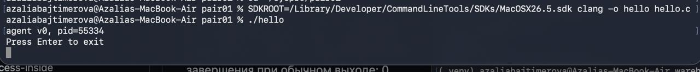
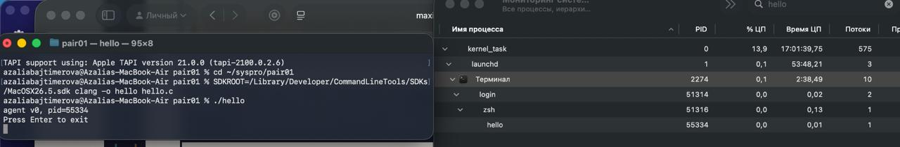
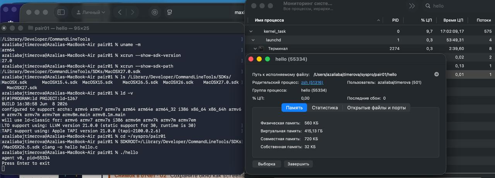
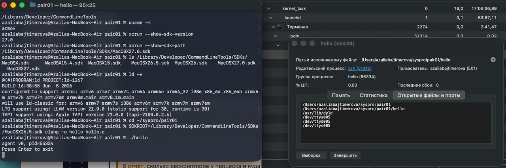
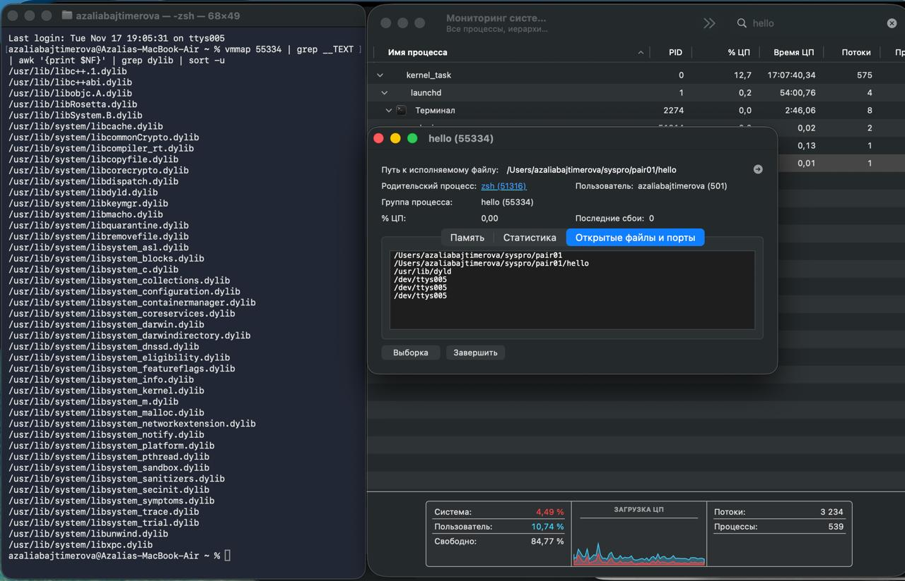
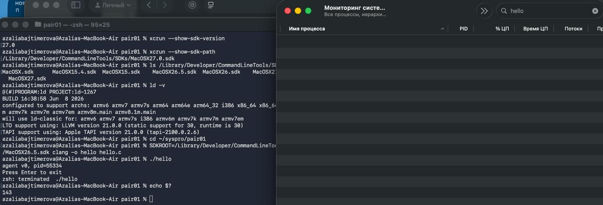
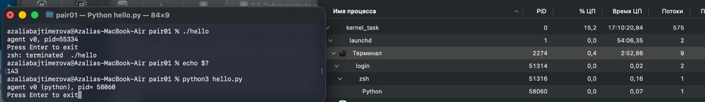
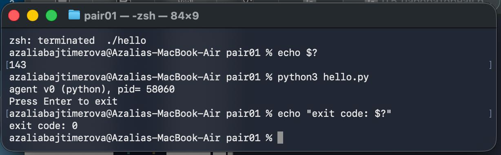

# ЛР 1. Процесс изнутри

Система: macOS Tahoe Версия 26.7 (25G229) · компилятор: Apple clang version 21.0.0

## Программа на C
Программа напечатала PID 55334, монитор показал PID 55334.
Память процесса в мониторе: 560. Процессорное время: 0,01.
Пока программа ждёт Enter, процессорное время не растёт, потому что процесс ожидает ввод пользователя и не выполняет вычисления.
Дескрипторов у процесса: Дескрипторов у процесса: 3. Дескриптор ввода (0) и дескрипторы вывода (1 и 2) ведут к устройству терминала /dev/ttys005.
В процессе загружены системные библиотеки: libSystem.B.dylib, libsystem_kernel.dylib, libsystem_c.dylib, libsystem_malloc.dylib, libsystem_pthread.dylib, libdispatch.dylib, libobjc.A.dylib, libc++.1.dylib, libc++abi.dylib и другие системные библиотеки macOS. Всего 44 библиотеки..
После завершения из монитора терминал напечатал zsh: terminated  ./hello, код завершения 143.

## Программа на Python
Имя процесса в мониторе: Python, PID 58060, память 1,2 мб.
Памяти больше, чем у программы на C, примерно 1200 ÷ 560 ≈ в 2,14 раз.
Общая библиотека у программ на C и Python: libSystem.B.dylib.
Код завершения при обычном выходе: Код завершения при обычном выходе: 0. Он отличается от кода 143 на шаге 8 тем, что программа завершилась самостоятельно, а на шаге 8 была остановлена извне сигналом SIGTERM..

Не получилось: ___

## Снимки экрана

### 1. Программа на C запущена
Шаг 1. Видно: команда сборки и строка `agent v0, pid=…` в терминале.

### 2. Свой процесс в мониторе
Шаг 3. Видно: строка процесса `hello` с тем же номером, что напечатала программа.

### 3. Свойства процесса
Шаг 4. Видно: окно процесса `hello`: номер, память, процессорное время.

### 4. Дескрипторы процесса
Шаг 5. Видно: открытые файлы или дескрипторы: папка программы и устройство терминала.

### 5. Библиотеки процесса
Шаг 6. Видно: загруженные библиотеки (в Linux — карта памяти).

### 6. Процесс завершён из монитора
Шаг 8. Видно: терминал после завершения: сообщение оболочки и код завершения.

### 7. Программа на Python в мониторе
Шаг 9. Видно: строка `agent v0 (python), pid=…` и процесс Python с тем же номером.

### 8. Обычный выход
Шаг 11. Видно: терминал после Enter: код завершения 0.

