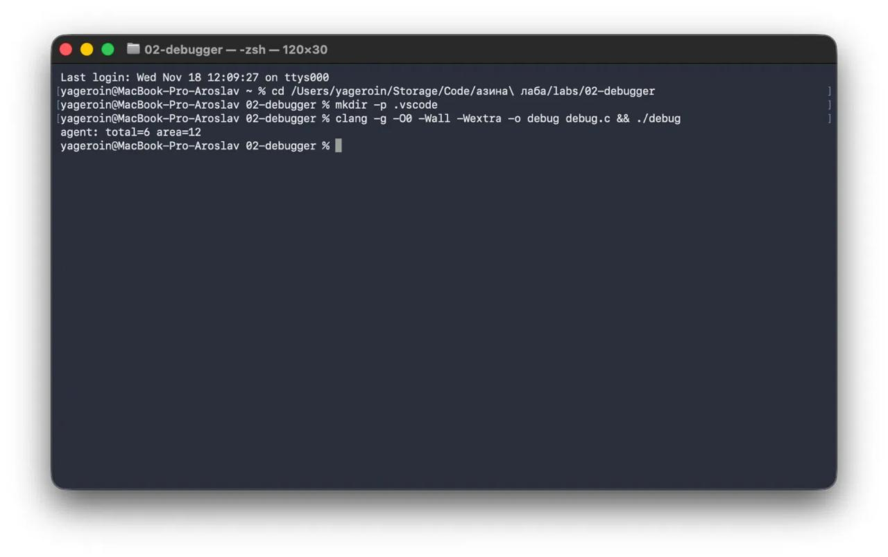
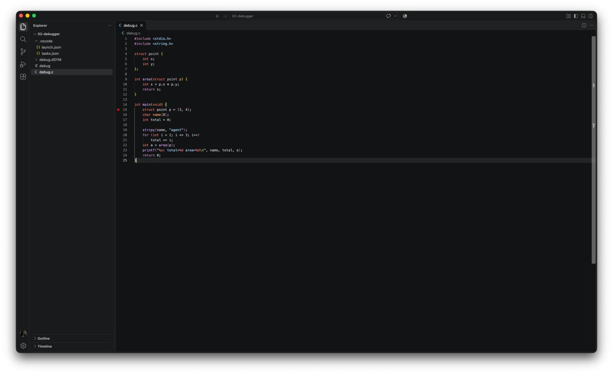
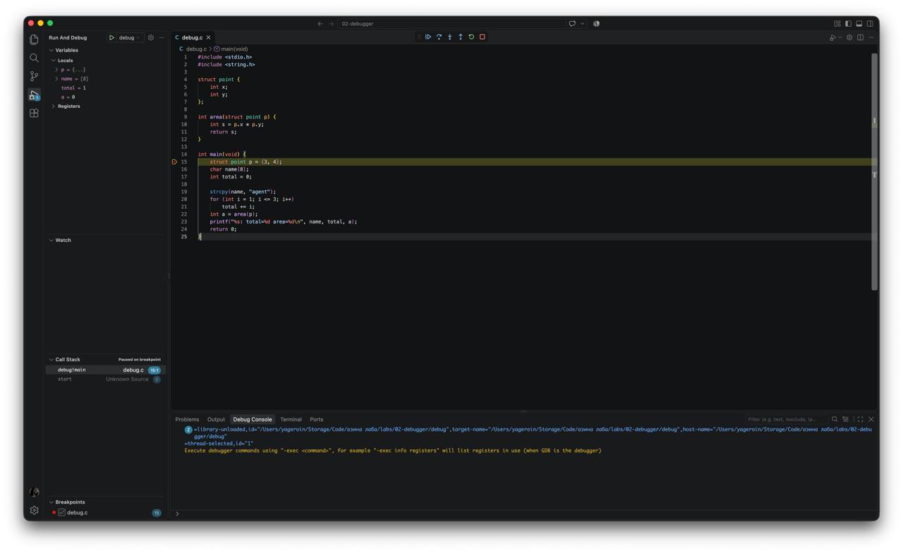
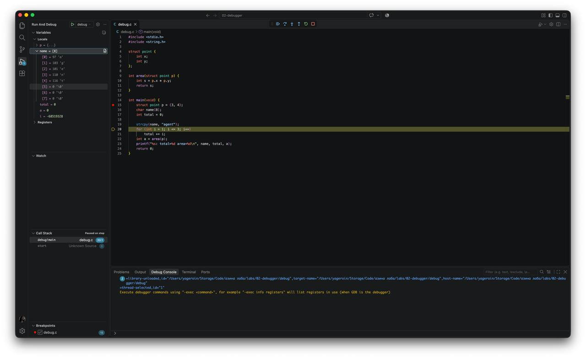
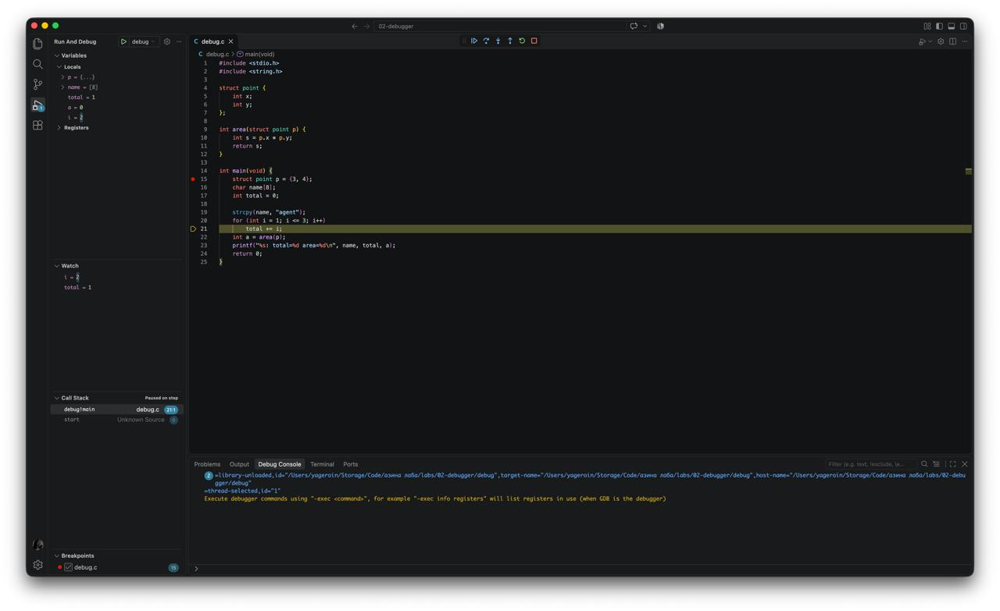
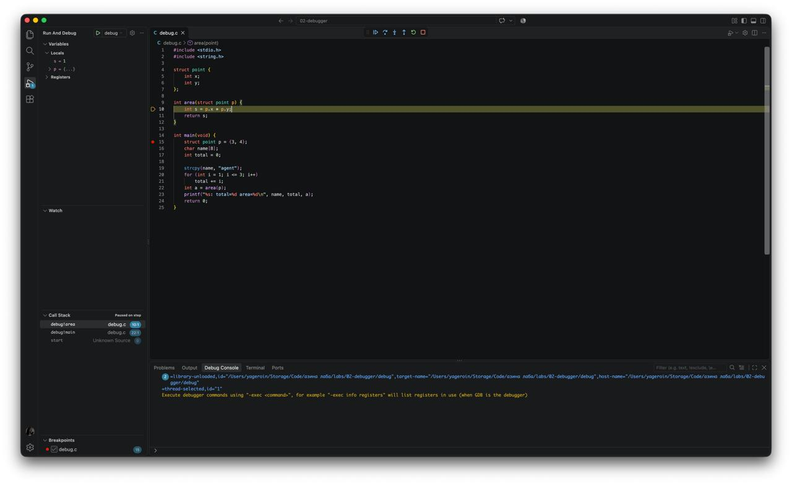
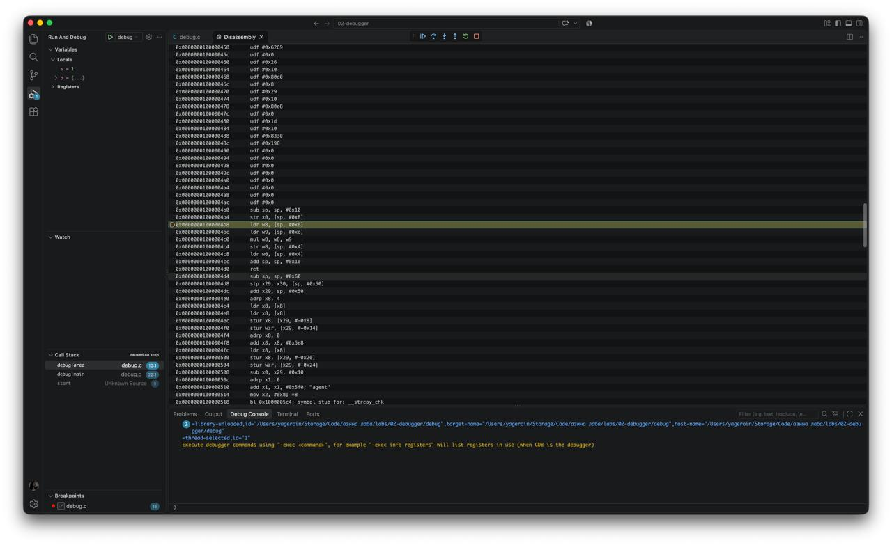
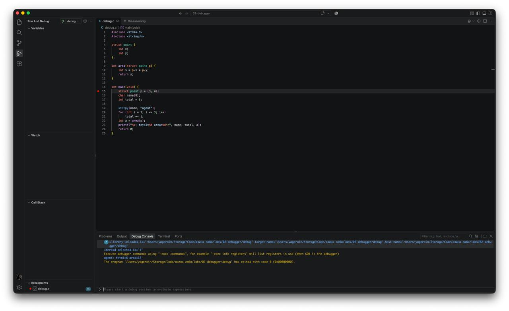

# ЛР 2. Программа в отладчике

Система: macOS (Apple Silicon) Tahoe Версия 26.6.2  · отладчик: LLDB

## Остановка и переменные
Программа без отладчика напечатала: agent: total=6 area=12

Точка останова на строке 15.

До строки 15: p.x = -16, p.y = -1, total = 1, a = 0.

После строки 15: p.x = 3, p.y = 4.

Строку 16 отладчик пропустил, потому что она только объявляет массив name, машинных команд для неё нет.

name[0] = 97 (код буквы 'a'), завершающий ноль в ячейке [5].

## Цикл и функция
На кадре цикла: i = 2, total = 1; после следующего шага total = 3.

В стеке внутри area строк: 2, сверху функция area, под ней main на строке 22.

Команда умножения в машинном коде: mul w8, w8, w9.

Перед printf: a = 12, total = 6.

Код завершения программы: 0.

## Снимки экрана

EOF
