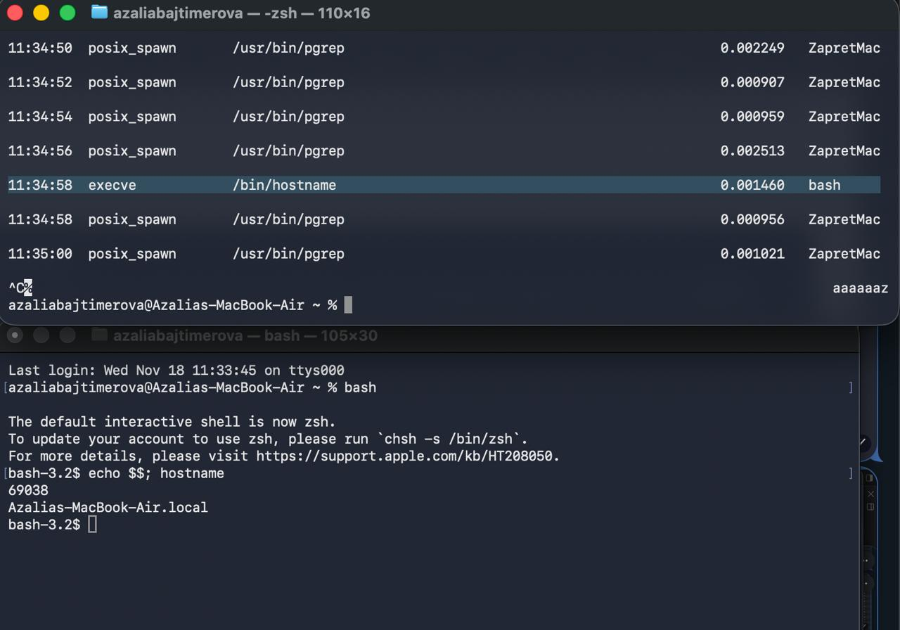
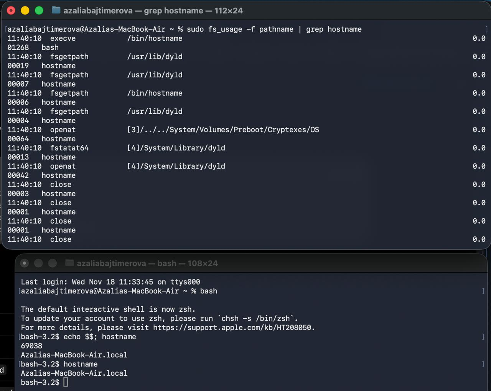
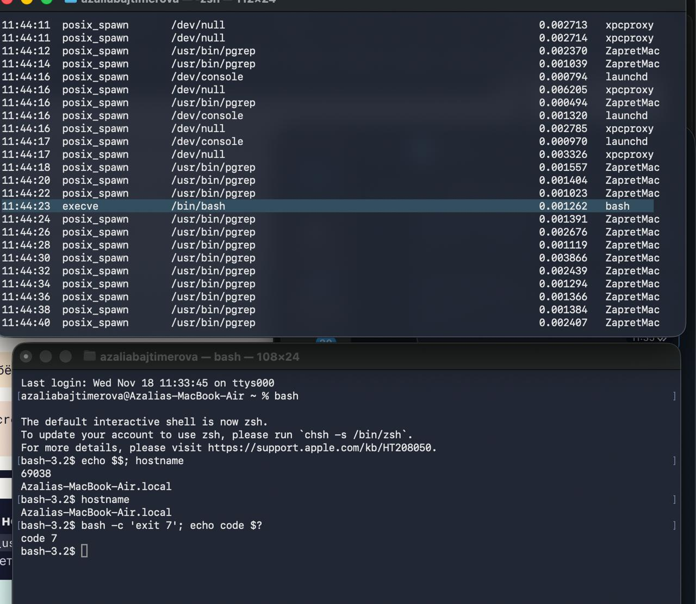
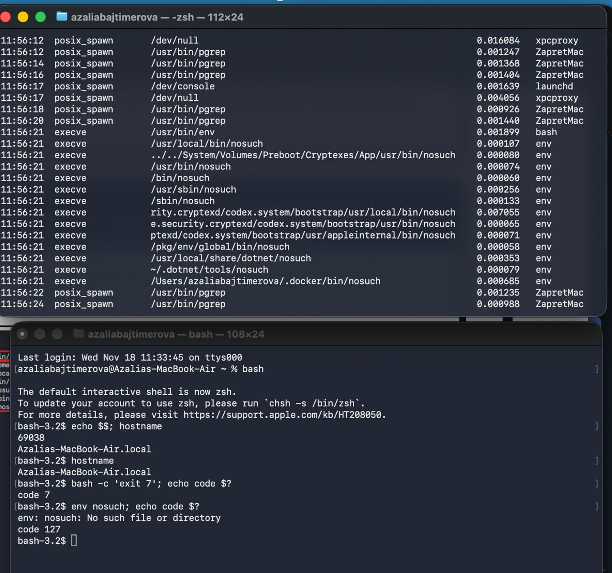
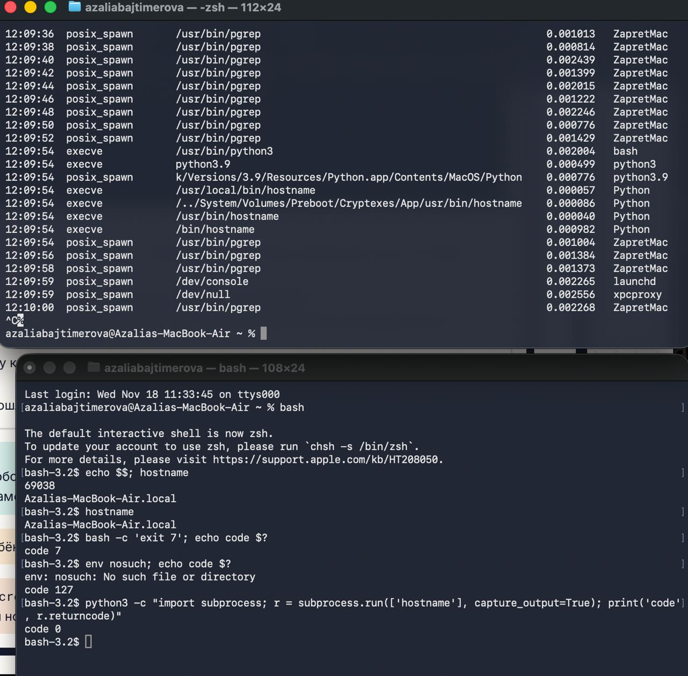

# ЛР 5. Рождение процесса

Система: macOS Tahoe Версия 26.7
Программа записи: fs_usage

## Рождение
Родитель (имя и номер): bash,67008
Номер нового процесса: 67008
Событие или вызов, которым создан процесс: fork (создание копии), затем execve (замена программы)
Библиотек загружено и первая из них: определить точное количество по этому выводу нельзя. Первая: /usr/lib/dyld (загрузчик динамических библиотек).

## Завершение
Код завершения у ребёнка и у родителя: Ребёнок завершился с кодом 7, родитель получил это значение через переменную $?.
Программа nosuch: папок проверено 13 (по числу попыток в записи), ошибка env: nosuch: No such file or directory, код 127

## Запуск из Python
Номер Python и номер ребёнка: 70516, 70517
Чем запуск из Python отличается от запуска из оболочки: Python запускает дочернюю программу с помощью модуля subprocess. В данном случае используется posix_spawn, который позволяет создать и запустить процесс одной заявкой. Python ожидает завершения программы и получает её код возврата через returncode.

## Снимки экрана

### 1. Рождение процесса
Шаг 1. Видно: запись запуска `hostname`: родитель создаёт процесс, у нового процесса номер родителя.

### 2. Библиотеки нового процесса
Шаг 2. Видно: библиотеки, которые загрузил `hostname`, и первая из них.

### 3. Код завершения 7
Шаг 3. Видно: завершение ребёнка с кодом 7 и тот же код у родителя.

### 4. Программы нет
Шаг 4. Видно: поиск `nosuch` по папкам из PATH и ошибка «не найдено».

### 5. Запуск из Python
Шаг 5. Видно: Python создаёт процесс `hostname`: номер Python и номер ребёнка.

