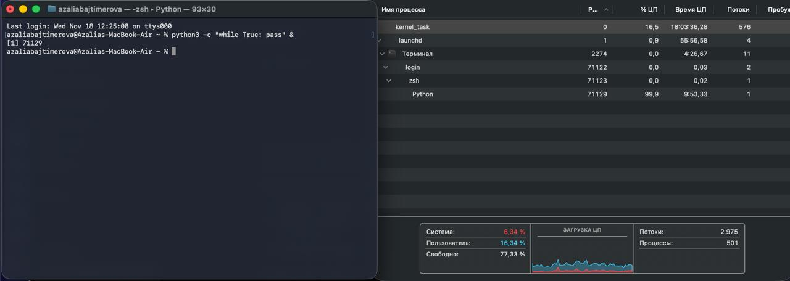
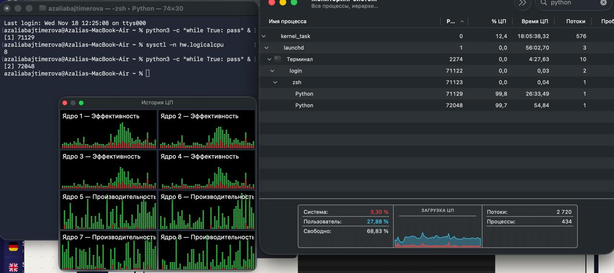
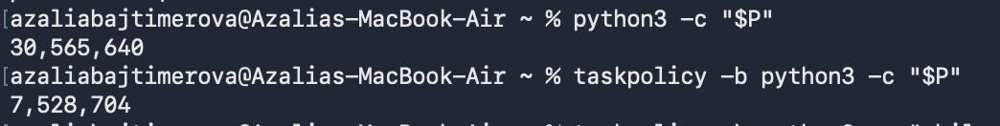
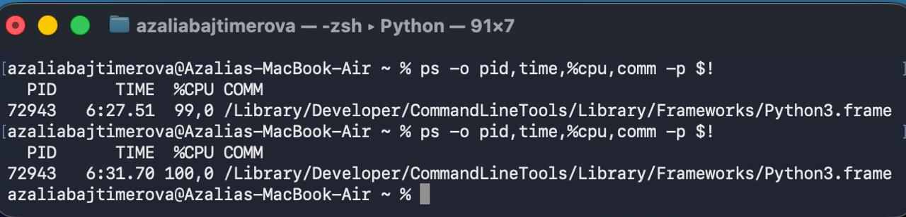

# ЛР 6. Кто загружает процессор

Система: macOS Tahoe Версия 26.7
Ядер (логических процессоров): 8

## Одна нагрузка
Процент процесса в мониторе: 99,9%
Общая загрузка: система-6,34%, пользователь-16,34% , свободно-77,33% 
На каких ядрах видна нагрузка: 5-8

## Две нагрузки
Проценты обеих нагрузок и общая загрузка:  Python №1 — 99,8%, Python №2 — 99,7%. Система — 3,30%, пользователь — 27,88%, свободно — 68,83%.
На одном ядре (в macOS — фоновый режим): использована команда taskpolicy -b, которая переводит процесс в фоновый режим.

## Процессорное время
Первый замер: 6:27.51.

Второй замер: 6:31.70.

Пауза: примерно 5 секунд.

Загрузка по замерам: (391,70 - 387,51) / 5 × 100 ≈ 83,8%.

Почему процент в мониторе не говорит о скорости работы: процент показывает, насколько сильно занято ядро процессора, но не количество выполненной работы. На быстрых и экономных ядрах при одинаковой загрузке около 100% скорость выполнения может отличаться. В моём эксперименте обычный запуск сделал 30 565 640 оборотов за 3 секунды, а фоновый — 7 528 704, то есть примерно в 4 раза меньше.

## Снимки экрана

### 1. Одна нагрузка
Шаг 1. Видно: процесс Python в мониторе: его процент и общая загрузка.

### 2. Две нагрузки
Шаг 3. Видно: два процесса Python и загрузка ядер.

### 3. Нагрузки на одном ядре
Шаг 4. Видно: две нагрузки на одном ядре и их проценты; в macOS — два числа оборотов цикла.

### 4. Процессорное время
Шаг 5. Видно: два замера процессорного времени с паузой между ними.

