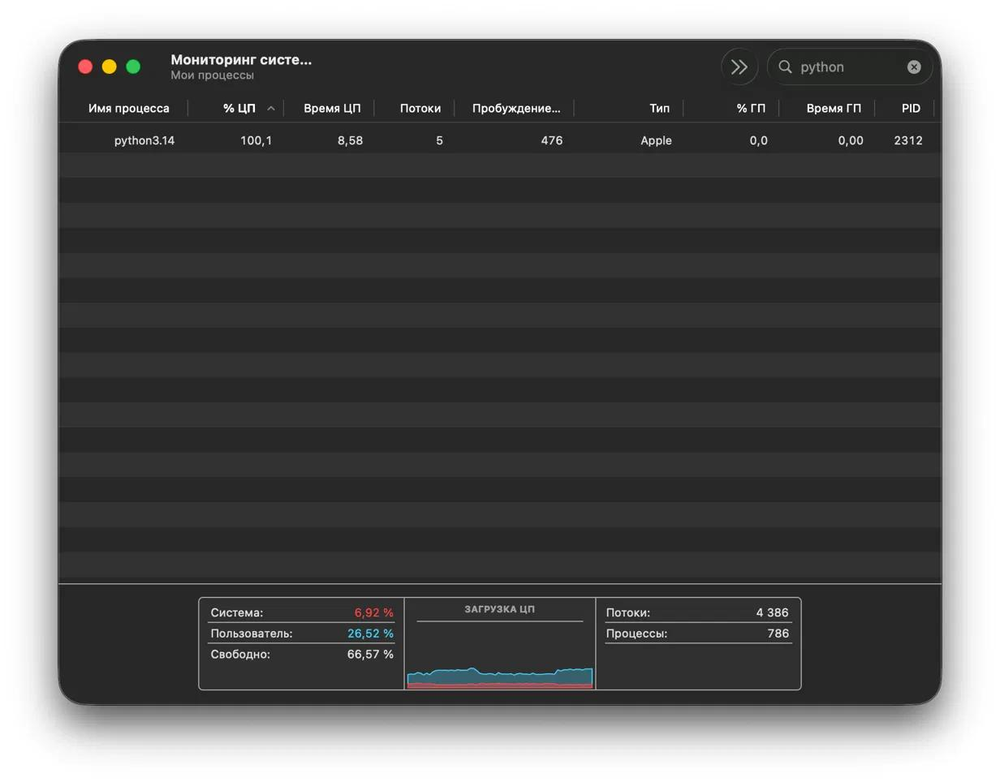
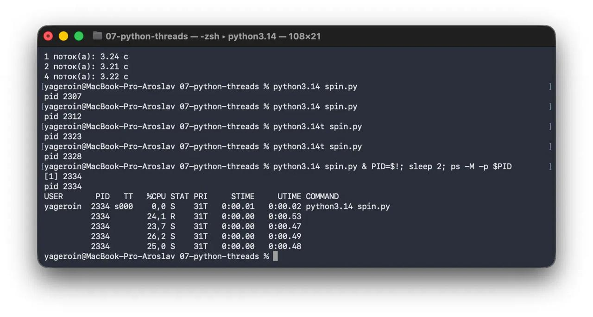
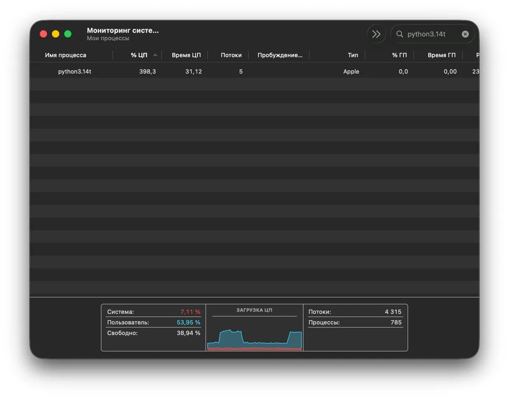
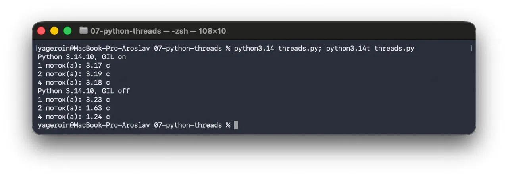

# ЛР 7. Потоки Python и GIL

Система: macOS (Apple Silicon, aarch64)
Ядер (логических процессоров): 10
Версии Python (обычный и без GIL): Python 3.14.10 (обычный), Python 3.14.10 (3.14t, без GIL)

## Python с GIL
Процент процесса и число потоков: 100,1 %, 5 потоков (скрин 01)

Сколько потоков выполняется одновременно: 1. В ps -M у одного потока состояние R (24,1 %), у трёх S (23,7, 26,2, 25,0 %). Вместе около одного ядра (скрин 02).

## Python без GIL
Процент процесса и проценты потоков: 398,3 % на процесс, 5 потоков (скрин 03). Проценты отдельных потоков на скрине не видны.

## Время работы
С GIL, 1 / 2 / 4 потока: 3,17 / 3,19 / 3,18 с

Без GIL, 1 / 2 / 4 потока: 3,23 / 1,63 / 1,24 с

Без GIL с PYTHON_GIL=1: 3,24 / 3,21 / 3,22 с (из отдельного запуска)

Ожидание, 1 и 4 потока: 2,01 с / 2,01 с

Почему ожидающие потоки ускоряются и с GIL: во время сна поток отдаёт GIL, поэтому все четыре потока спали одновременно. Четыре ожидания по 2 секунды заняли столько же времени, сколько одно.

Вывод: с GIL четыре потока не ускоряют счёт: время одинаковое на 1, 2 и 4 потоках. 

Без GIL четыре потока работают в 2,6 раза быстрее одного (3,23 / 1,24). Это меньше, чем 3,3 раза из задания, потому что на этом Mac другое число ядер и другая нагрузка. 

С PYTHON_GIL=1 ускорения нет, значит ускорение даёт отсутствие замка. Процесс без GIL занимает почти четыре ядра (398,3 %), а с GIL — одно (100,1 %).

## Снимки экрана

