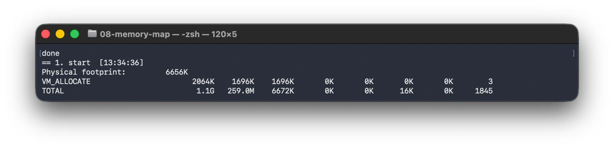
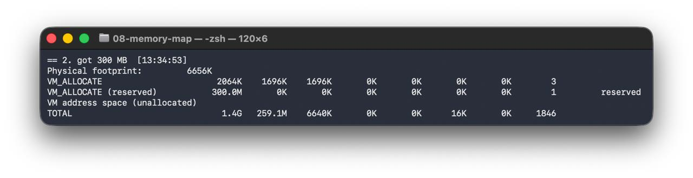
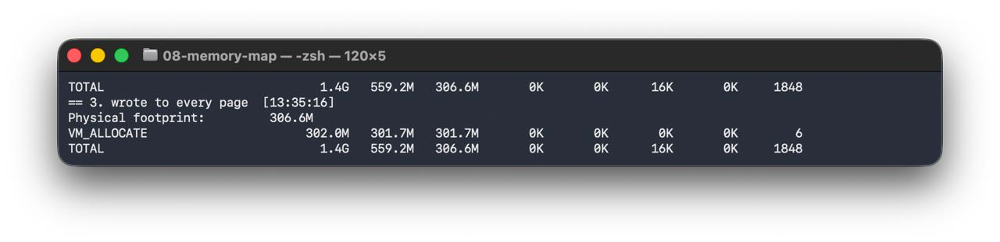
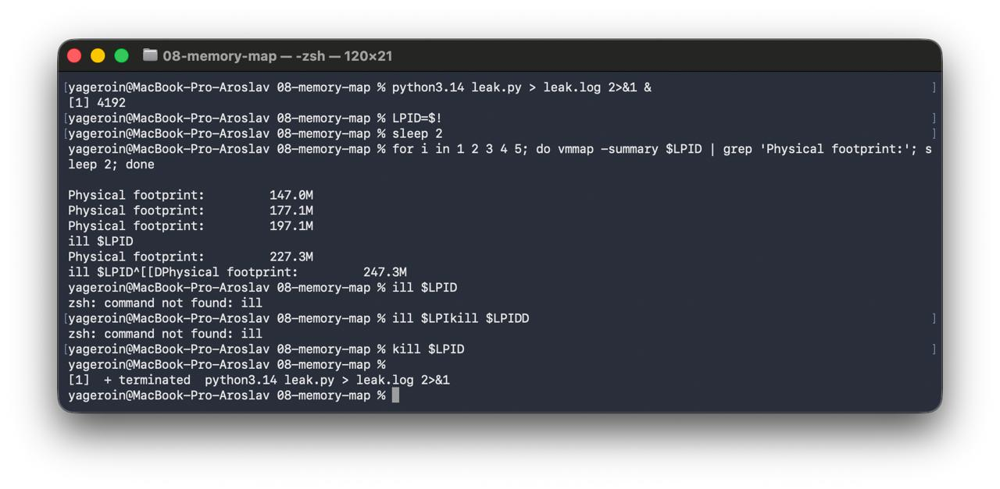

# ЛР 8. Карта памяти

Система: ___
Чем мерил (виртуальная и занятая): ___

## Этапы mem.py
Старт: обещано 435 635 664 КБ (около 415 ГБ), занято 6656K (физический след)

Получил 300 МБ: обещано не изменилось по ps, в vmmap появилась строка VM_ALLOCATE (reserved) 300,0M, занято 6656K

Записал в каждую страницу: обещано тем же, занято 306,6M (физический след)

Освободил: занято 6624K, VM_ALLOCATE 1696K, память вернулась к старту

Почему занятая память выросла только на третьем этапе: на этапе получения 300 МБ программа только просит адреса, а страницы реально занимает при первой записи. До записи физический след не менялся (6656K), после записи вырос до 306,6M.

## Карта памяти
Из каких частей состоит память процесса: код Python и библиотек (__TEXT, около 153 МБ занято), данные (__DATA), рабочая память (MALLOC_SMALL, около 1,7 МБ), стек (48K), выделенная программой память (VM_ALLOCATE, 1696K занято). Итог TOTAL: 259,8M занято, 6672K грязных страниц.

## Утечка
Пять замеров leak.py: 147,0M, 177,1M, 197,1M, 227,3M, 247,3M

На сколько росла память за 2 секунды: около 20–30 МБ за каждые 2 секунды, без остановки. Это признак утечки.

Не получилось: первый прогон с ожиданием этапов по таймеру сбился, замеры переснял одним циклом.

## Снимки экрана

Сохраните снимок поверх заглушки в папке `screenshots/` с тем же именем — ссылки ниже менять не нужно.

### 1. Карта памяти
Шаг 2. Видно: карта памяти процесса mem.py на старте и её итог.

### 2. Получено 300 МБ
Шаг 3. Видно: виртуальная память выросла на 300 МБ, занятая — нет.

### 3. Страницы заняты
Шаг 4. Видно: занятая память (в macOS — физический след) после записи в каждую страницу.

### 4. Утечка
Шаг 6. Видно: пять замеров памяти leak.py.

