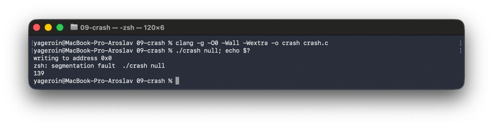
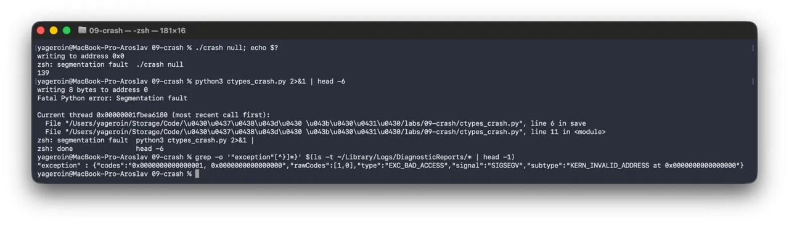
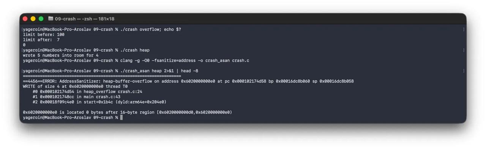
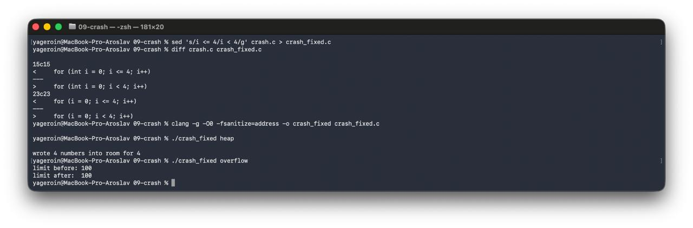

# ЛР 9. Разбор падения

Система: macOS (Apple Silicon) Tahoe Версия 26.6.2 
Компилятор: clang (Command Line Tools)

## Падение
crash null: программа напечатала writing to address 0x0, код завершения 139 (SIGSEGV, zsh: segmentation fault).

ctypes_crash.py: Python напечатал writing 8 bytes to address 0, затем Fatal Python error: Segmentation fault, в строке line 6 in save, вызванной из line 11.

Где система записала падение: отчёт в ~/Library/Logs/DiagnosticReports: type EXC_BAD_ACCESS, signal SIGSEGV, subtype KERN_INVALID_ADDRESS at 0x0.

## Молчаливые ошибки
crash overflow: limit before: 100, limit after: 7, код завершения 0. Программа не упала, а данные испортились.

crash heap без проверки: wrote 5 numbers into room for 4, ошибки никто не заметил.

AddressSanitizer для heap: heap-buffer-overflow, WRITE of size 4, строка crash.c:24 (data[i] = 7 при i = 4). Запись на 0 bytes after 16-byte region.

AddressSanitizer для uaf: heap-use-after-free, READ в строке crash.c:33 (printf), память отдана в строке crash.c:32 (free).

## Исправление
Изменено: два условия цикла i <= 4 заменены на i < 4 (строки 15 и 23, файл crash_fixed.c). Исправленная программа напечатала wrote 4 numbers into room for 4, limit before: 100, limit after: 100. С проверкой AddressSanitizer отчёта об ошибке нет.

## Снимки экрана

Сохраните снимок поверх заглушки в папке `screenshots/` с тем же именем — ссылки ниже менять не нужно.

### 1. Падение
Шаг 1. Видно: запуск crash null и код завершения.

### 2. Падение Python
Шаг 2. Видно: вывод ctypes_crash.py и запись системы о падении.

### 3. Отчёт AddressSanitizer
Шаг 4. Видно: вывод crash heap без проверки и с AddressSanitizer (на Windows с ARM — без проверки).

### 4. Исправление
Шаг 6. Видно: разница файлов и вывод исправленной программы.

